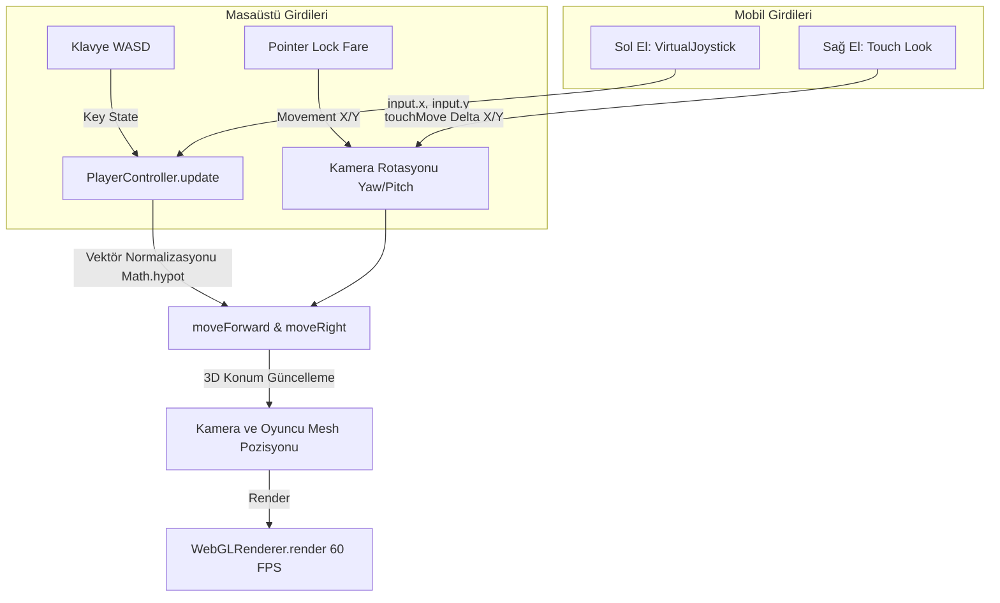

# Çok Platformlu Minimalist Arena FPS - Mimari Dokümantasyonu (ARCHITECTURE.md)

Bu dokümantasyon, projenin modüler yapısını, veri akışını, bileşenlerin sorumluluklarını ve haftalık teslimat/test sonuçlarını kayıt altına almak amacıyla tutulmaktadır.

---

## 1. Teknoloji Yığını (Tech Stack)
* **Frontend / Oyun Motoru:** Three.js (r187) + React 19 + Vite
* **Hedef Platformlar:** Web, Masaüstü (Electron/Tauri), Mobil (Capacitor ile Android APK)
* **Backend (3. Hafta):** Python (FastAPI) + WebSockets
* **Dağıtım (5. Hafta):** Docker & Google Cloud Run

---

## 2. Proje Klasör Mimarisi ve Sorumluluk Dağılımı

Oyun motoru mantığı ile React UI bileşenlerini birbirinden izole etmek için **ayrık sorumluluk (Separation of Concerns)** prensibi uygulanmıştır:

```text
src/
├── game/
│   ├── world/
│   │   └── ArenaMap.js         # Harita geometrileri (zemin, dış duvarlar, siperler, ışıklandırma) ve collider havuzu.
│   ├── controls/
│   │   ├── PlayerController.js # Hibrit Kontrol Merkezi: Masaüstü (Pointer Lock + WASD) ve Mobil (Joystick + Touch) yöneticisi.
│   │   └── VirtualJoystick.js  # Mobil ekran için saf JavaScript analog dokunmatik joystick modülü.
├── App.jsx                     # Three.js motorunu başlatan ve UI katmanını (HUD, Crosshair) yöneten ana React bileşeni.
ARCHITECTURE.md                 # Haftalık teknik dokümantasyon ve mimari analiz dosyası.
```

---

## 3. 1. Hafta Mimarisi: 3D Sahne, Harita ve Hibrit Kontroller

### 3.1. Rendering ve Oyun Döngüsü (Game Loop)
* **Three.js Scene:** Tüm 3D nesnelerin barındığı hiyerarşik ağaç yapısı.
* **PerspectiveCamera:** İnsan gözü perspektifine uygun (FOV: 55°, Aspect: En/Boy Oranı) 1. şahıs bakış kamerası.
* **WebGLRenderer:** Donanım ivmeli (GPU) çizim motoru.
* **Game Loop (`requestAnimationFrame`):** Ekran yenileme hızında (60 FPS) çalışan, kontrolleri ve nesne konumlarını kare bazında güncelleyen ana motor döngüsü.

### 3.2. Harita ve Çevre Mimarisi (`ArenaMap.js`)
* **PBR Aydınlatma Sistemi:**
  * `AmbientLight (0xffffff, 0.6)`: Gölgelerin tamamen siyah kalmasını engelleyen yumuşak dolgu ışığı.
  * `DirectionalLight (0xffffff, 0.8)`: Açılı vuran güneş ışığı; nesnelerin 3D derinlik ve kenar hatlarını ortaya çıkarır.
* **Geniş Arena & Taktiksel Siperler:**
  * 60x60 birimlik antrasit zemin (`MeshStandardMaterial`).
  * 4 adet sınır duvarı (`height: 5`).
  * Taktiksel çatışma siperleri ve köşe kuleleri.
---

### 3.3. Hibrit Kontrol Sistemi Veri Akışı (Data Flow)

Aşağıdaki şema, klavye, fare ve dokunmatik girdilerin `PlayerController` içinde nasıl birleşip 3D harekete dönüştüğünü gösterir:



---

## 4. Matematiksel ve Teknik Çözümler (Code Defense)

1. **Çapraz Hız Düzeltmesi (Diagonal Normalization):**
   * *Problem:* Oyuncu hem W hem D tuşuna bastığında karakter %41 daha hızlı koşar.
   * *Çözüm:* `Math.hypot(forward, right)` ile bileşke hız hesaplanır; eğer 1'den büyükse bileşenler vektör uzunluğuna bölünerek hız tam 1.0'a sabitlenir.
2. **Kafa Takla Atma Engeli (Pitch Clamping):**
   * Fare veya parmak yukarı-aşağı kaydırıldığında kameranın ters dönmesini engellemek için `camera.rotation.x` açısı `[-85°, +85°]` (`[-Math.PI/2 + 0.05, +Math.PI/2 - 0.05]`) aralığına hapsedilmiştir (`Math.max/min`).
3. **Pointer Events ile Hibrit Uyumluluk:**
   * `VirtualJoystick` modülünde `mousemove` veya `touchmove` yerine standart **`Pointer Events`** (`pointerdown`, `pointermove`, `pointerup`) kullanılmıştır. Bu sayede joystick hem mobilde gerçek dokunmatik parmakla hem de bilgisayarda fareyle test edilebilmektedir.
4. **Çok Oyunculu (Multiplayer) Hazırlığı:**
   * Birinci şahıs görünümde kamera hareket ederken, `this.player.position` da kameranın tam altına eşitlenmektedir. Bu sayede 3. haftada soket üzerinden gönderilecek konum verisi şimdiden hazır durumdadır.

---

## 5. 1. Hafta Test Sonuçları Raporu

| Test Senaryosu | Test Ortamı / Cihaz | Beklenen Sonuç | Alınan Sonuç | Durum |
| :--- | :--- | :--- | :--- | :---: |
| **Arena Render & Işıklandırma** | Windows 11 / Chrome | 3D siperlerin ve zemin materyalinin düzgün aydınlatılması | PBR ışıklar ve gölgeler pürüzsüz yüklendi | **BAŞARILI** |
| **Masaüstü Pointer Lock** | Windows 11 / Chrome | Tıklamayla farenin kilitlenmesi, fareyle serbest bakış | İmleç kilitlendi, Pitch/Yaw sınırları korundu | **BAŞARILI** |
| **WASD Vektörel Yürüme** | Windows 11 / Klavye | Baktığı açıya göre yürüme ve çapraz hız dengesi | Farenin baktığı yöne doğru sabit hızla ilerledi | **BAŞARILI** |
| **Mobil Yerel Ağ Erişimi** | Android Chrome (Wi-Fi) | `http://192.168.1.110:5173` üzerinden tam ekran erişim | Site telefonda sorunsuz yüklendi | **BAŞARILI** |
| **Sanal Joystick (Sol El)** | Android Dokunmatik | 360 derece yönlendirme ve analog hız | Karakter telefonda her açıya akıcı şekilde yürüdü | **BAŞARILI** |
| **Dokunmatik Bakış (Sağ El)** | Android Dokunmatik | Ekranın sağ yarısını kaydırarak kamerayı çevirme | Sağ el parmağı ile gecikmesiz bakış açısı kontrol edildi | **BAŞARILI** |
| **FPS & Performans** | Masaüstü & Mobil | Sabit ekran yenileme hızı ve düşük CPU/GPU yükü | Her iki platformda da 60 FPS stabil çalıştı | **BAŞARILI** |

---

## 6. 2. Hafta Hazırlığı (Next Steps)
* **Yerçekimi ve Zıplama Fiziği:** Karakterin dikey hız (`velocityY`) ve zemin temas kontrolü.
* **Katı Engel Çarpışmaları (AABB Collision):** Karakterin `ArenaMap.colliders` listesindeki duvar ve siperlerin içinden geçmesini engelleyen fizik kuralları.
* **Raycasting ile Ateş Mekaniği:** Ekranın ortasındaki nişangah doğrultusunda ışın fırlatarak (Raycast) hedef vurma ve mermi izi (bullet tracer) efektleri.
