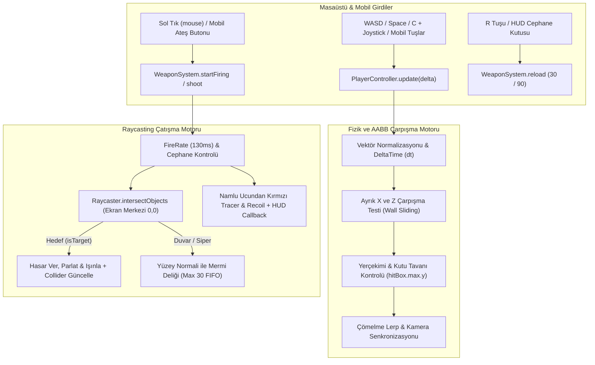

# Çok Platformlu Minimalist Arena FPS - Mimari Dokümantasyonu (ARCHITECTURE.md)

Bu dokümantasyon, projenin modüler yapısını, veri akışını, fizik/çatışma algoritmalarını ve haftalık teslimat/test sonuçlarını kayıt altına almak amacıyla tutulmaktadır.

---

## 1. Teknoloji Yığını (Tech Stack)
* **Frontend / Oyun Motoru:** Three.js (r187) + React 19 + Vite
* **Hedef Platformlar:** Web, Masaüstü (Electron/Tauri), Mobil (Capacitor ile Android APK)
* **Backend (3. Hafta):** Python (FastAPI) + WebSockets
* **Dağıtım (5. Hafta):** Docker & Google Cloud Run

---

## 2. Proje Klasör Mimarisi ve Sorumluluk Dağılımı

Oyun motoru mantığı ile React UI bileşenlerini birbirinden izole etmek için **ayrık sorumluluk (Separation of Concerns)** prensibi uygulanmıştır:

```text
src/
├── game/
│   ├── world/
│   │   └── ArenaMap.js         # Harita geometrileri (zemin, duvarlar, siperler, hedefler), ışıklar ve AABB collider havuzu.
│   ├── controls/
│   │   ├── PlayerController.js # Hibrit Kontrol & Fizik Merkezi: WASD/Joystick, Yerçekimi, Zıplama, Çömelme ve Çarpışma.
│   │   └── VirtualJoystick.js  # Mobil ekran için saf JavaScript analog dokunmatik joystick modülü.
│   └── combat/
│       └── WeaponSystem.js     # Raycasting ateş sistemi, 3B silah modeli, mermi izi, mermi delikleri ve 30/90 cephane yönetimi.
├── App.jsx                     # Three.js döngüsünü (Clock/ResizeObserver) ve HUD arayüzünü (Crosshair, Cephane, Mobil Tuşlar) yönetir.
├── index.css                   # Tam ekran kilidi, dokunmatik zoom ve sayfa esnemesi (overscroll) engelleme kuralları.
ARCHITECTURE.md                 # Haftalık teknik dokümantasyon ve mimari analiz dosyası.
```

---

## 3. 1. Hafta Mimarisi: 3D Sahne, Harita ve Hibrit Kontroller

### 3.1. Rendering ve Oyun Döngüsü (Game Loop)
* **Three.js Scene:** Tüm 3D nesnelerin barındığı hiyerarşik ağaç yapısı.
* **PerspectiveCamera:** İnsan gözü perspektifine uygun (`FOV: 55°`, `Near: 0.1m`, `Far: 1000m`) 1. şahıs bakış kamerası.
* **WebGLRenderer:** Donanım ivmeli (GPU) çizim motoru (`antialias: true`, mobil ısınma önlemi için `devicePixelRatio` maksimum `2` ile sınırlandırılmıştır).
* **Game Loop (`requestAnimationFrame` + `THREE.Clock`):** Ekran yenileme hızında çalışan ve `deltaTime` ile 60Hz–144Hz tüm ekranlarda eşit fiziksel hız üreten ana döngü.

### 3.2. Harita ve Çevre Mimarisi (`ArenaMap.js`)
* **PBR Aydınlatma Sistemi:**
  * `AmbientLight (0xffffff, 0.6)`: Gölgelerin zifiri siyah kalmasını engelleyen ortam ışığı.
  * `DirectionalLight (0xffffff, 0.8)`: `(20, 40, 20)` koordinatından vuran yönlü güneş ışığı; yüzey ton farklarıyla 3B derinlik algısını oluşturur.
* **Geniş Arena, Taktiksel Siperler ve Hedefler:**
  * `60x60` metrelik zemin (`PlaneGeometry`, `-Math.PI / 2` radyan döndürülmüş), `5m` dış sınır duvarları, `2m` ve `3m` turkuaz siperler, `6m` köşe sütunları ve vurulabilir antrenman hedefleri (`targets`).

---

## 4. 2. Hafta Mimarisi: Fizik Motoru, Çarpışma ve Raycasting Silah Sistemi

### 4.1. Kare Hızından Bağımsız Fizik, Zıplama ve Çömelme (`PlayerController.js`)
* **Delta Time Eşitlemesi (`THREE.Clock`):** 60Hz masaüstü monitör ile 120Hz mobil ekran arasındaki hız farkını ortadan kaldırmak için tüm hız ve ivme değerleri saniye birimine (`speed = 9.0 m/sn`, `gravity = 42.0 m/sn²`, `jumpStrength = 14.8 m/sn`) çevrilmiş ve `dt = Math.min(delta, 0.05)` ile çarpılmıştır.
* **Yerçekimi ve Zıplama:** `isGrounded` bayrağı ile havada çift zıplama (Double Jump) engellenmiştir. Karakter hem ana zeminde (`y = 0.9`) hem de alçak siperlerin tavanında durabilir ve tekrar zıplayabilir.
* **Taktiksel Çömelme (Crouch & Lerp):** Masaüstünde `KeyC` / `ControlLeft` basılı tutularak, mobilde `▼` butonuyla (`toggleCrouch`) aktifleşir. Yürüme hızı `4.5 m/sn` değerine düşer, oyuncu gövdesi küçülür (`scale.y = 0.6`) ve kamera göz hizası `Lerp` formülü (`cameraOffsetY += (targetOffset - cameraOffsetY) * Math.min(1, 12 * dt)`) ile `+0.7m`'den `+0.15m`'ye pürüzsüzce iner.

### 4.2. Katı Engel Çarpışmaları (`AABB` & Wall Sliding)
* **Eksen Ayrık Çarpışma (Wall Sliding):** Karakter duvara çapraz açıyla koştuğunda takılıp kalmaması için `checkCollision(x, y, z)` testi **önce yalnızca X ekseninde**, **ardından yalnızca Z ekseninde** ayrı ayrı çalıştırılır. Engel olmayan eksende hareket devam eder.
* **Kutu Üstüne Çıkma ve Epsilon Payı (`+ 0.901`):** Dikey harekette `hitBox` tespit edildiğinde `velocityY <= 0` ise karakter kutunun tavanına (`hitBox.max.y + 0.901`) oturtulur (`0.001m` pay, kutu üstünde yürürken yatay sürtünme kilitlenmesini önler). `velocityY > 0` ise kafa çarpması olarak algılanıp hız sıfırlanır.
* **Dinamik Hedef Collider'ı:** Antrenman hedefleri 3 isabette rastgele konuma ışınlandığında eski yerinde görünmez duvar kalmaması için `hitObject.userData.collider.setFromObject(hitObject)` ile çarpışma kutusu da yeni konuma taşınır.

### 4.3. Raycasting Ateş, Mermi Deliği ve Cephane Sistemi (`WeaponSystem.js`)
* **3B Silah Modeli (Parent-Child) ve Recoil:** Silah mesh'i `camera.add(gun)` ile kameranın çocuğu yapılmış, namlu ucuna yerleştirilen `muzzle` (`Object3D`) üzerinden `getWorldPosition` ile mermi çıkış noktası hesaplanmıştır. Her atışta silah `70ms` süreli geri tepme (recoil) hareketi yapar.
* **Hitscan (`THREE.Raycaster`) ve Siper Koruması:** Ekranın tam merkezinden (`Vector2(0, 0)`) fırlatılan ışın `mapGroup.children` nesnelerini mesafeye göre sıralar (`intersects[0]`). Hedefin önünde siper varsa ilk çarpılan nesne siper olduğu için mermi arkadaki hedefe geçmez.
* **Mermi İzi (Tracer) ve Mermi Delikleri (Bullet Holes):**
  * Namlu ucundan vuruş noktasına `60ms` ömürlü kırmızı lazer çizgisi (`THREE.Line`) çizilir ve süre sonunda `geometry/material.dispose()` ile VRAM'den temizlenir.
  * Duvar ve siperlere isabet eden mermiler, yüzey normali (`hit.face.normal`) doğrultusunda çevrilip **Z-Fighting** (yüzey titremesi) olmaması için yüzeyin `0.005m` önüne yerleştirilir. Bellek sızıntısını önlemek adına **FIFO kuyruğu (`shift()`)** ile sahnede en fazla son `30` mermi deliği tutulur.
* **Otomatik Tarama ve `30 / 90` Cephane Matematiği:** `performance.now()` tabanlı `130ms` atış hızı sınırı (`fireRate`), `1200ms` süreli `R` şarjör değiştirme animasyonu ve `Math.min(needed, reserveAmmo)` yedek cephane aktarımı uygulanmıştır. Arayüz senkronizasyonu sadece mermi değiştiğinde çalışan `onAmmoChange` callback fonksiyonuyla sağlanır.

---

### 4.4. 2. Hafta Sistem Veri Akışı (Mermaid Şeması)



---

## 5. Mobil Uyumluluk ve Platform Çözümleri (Code Defense)

1. **`100vh` vs `innerHeight` Nişangah Kayması Çözümü:**
   * *Problem:* Mobil tarayıcılarda yatay ekranda `100vh` adres çubuğu arkasını da saydığı için HTML nişangah ile `<canvas>` merkezi birbirinden kayıyordu.
   * *Çözüm:* Kapsayıcı `position: fixed; inset: 0` ile gerçek görünür ekrana kilitlendi ve `ResizeObserver` ile `<canvas>` boyutu doğrudan `mountRef.current.clientWidth/Height` değerine eşitlendi.
2. **Cihaz Türü Ayrımı (`e.pointerType === 'mouse'`):**
   * *Problem:* Android Chrome'da ekrana dokunulduğunda `PointerLockControls` devreye girip sistem uyarısı çıkarıyor ve sahte `mousedown` sinyaliyle yürürken ateş ediyordu.
   * *Çözüm:* Fare kilitleme ve masaüstü sol tık ateşi `e.pointerType === 'mouse'` şartıyla yalnızca fiziksel fareye sınırlandırıldı.
3. **Çift Dokunma Zoom ve Sayfa Esnemesi Kilidi:**
   * `index.html` (`user-scalable=no, maximum-scale=1.0`) ve `index.css` (`touch-action: none`, `overscroll-behavior: none`) ile hızlı ardışık atışlarda ekran yakınlaşması tamamen engellendi.

---

## 6. Haftalık Test Sonuçları Raporu

| Test Senaryosu | Test Ortamı / Cihaz | Beklenen Sonuç | Alınan Sonuç | Durum |
| :--- | :--- | :--- | :--- | :---: |
| **1. Hafta: Hibrit Yürüme & Bakış** | Windows 11 & Android Wi-Fi | WASD + Pointer Lock ve Mobil Joystick + Sağ El Bakış | Her iki platformda akıcı kontrol sağlandı | **BAŞARILI** |
| **2. Hafta: 60Hz / 120Hz Hız Eşitleme** | PC (60Hz) & Mobil (120Hz) | `deltaTime` ile her iki cihazda birebir aynı yürüme/zıplama hızı | `9.0 m/sn` sabit hız doğrulandı | **BAŞARILI** |
| **2. Hafta: AABB Wall Sliding & Siper Üstü** | Masaüstü & Mobil | Duvarlardan geçmeme, çaprazda kayma ve `2m` siper üstüne çıkma | Takılmasız kayma ve siper üstü duruş çalıştı | **BAŞARILI** |
| **2. Hafta: Çömelme (Crouch Lerp)** | Klavye (`C`/`Ctrl`) & Mobil (`▼`) | Göz hizasının yumuşak alçalması ve hızın yarıya düşmesi | Siper arkası tam gizlenme sağlandı | **BAŞARILI** |
| **2. Hafta: Raycast, Siper Engeli & Delikler** | Masaüstü & Mobil | Hedef vurma/ışınlama, siperin mermiyi kesmesi ve duvarda iz | Kırmızı lazer, 30 limitli delik ve dinamik collider çalıştı | **BAŞARILI** |
| **2. Hafta: Taramalı Ateş & `30/90` Cephane** | Masaüstü (`R`) & Mobil HUD | Basılı tutarak tarama ve eksik mermi kadar yedekten doldurma | `30/90` -> `30/60` cephane matematiği doğrulandı | **BAŞARILI** |
| **2. Hafta: Mobil Yatay Nişangah & Zoom Kilidi** | Android Yatay Ekran | Merminin tam nişangaha gitmesi ve çift basmada zoom olmaması | Piksel hassasiyetinde nişan ve kilit doğrulandı | **BAŞARILI** |

---

## 7. 3. Hafta Hazırlığı (Next Steps)
* **Python (FastAPI) WebSocket Sunucusu:** Oyuncuların gerçek zamanlı konum (`x, y, z`), bakış açısı (`yaw`), çömelme durumu (`isCrouching`) ve atış paketlerini yayınlayan düşük gecikmeli backend.
* **Çok Oyunculu (Multiplayer) Senkronizasyon:** Odaya bağlanan diğer oyuncuların arenada mavi/kırmızı karakter modelleri olarak canlandırılması, can (`HP`) ve skor tablosu.
